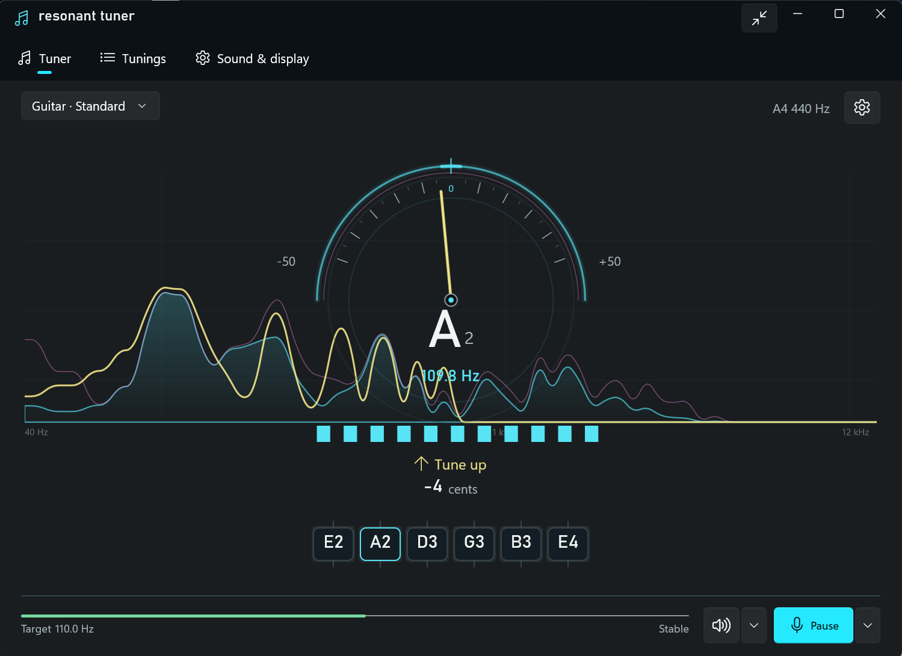

# Resonant Tuner

[](https://github.com/tinodo/Resonant-Tuner/actions/workflows/ci.yml)
[](LICENSE)

A fast, accurate and fully offline instrument tuner for Windows. Pluck a string, see how far off it is, and tune with confidence. Everything is processed in memory on your device: no recording, no uploads, no accounts, no telemetry.

Built with WinUI 3, C# and .NET 10. Website: <https://tinodo.github.io/Resonant-Tuner/>



## Features

- **Accurate pitch detection.** A YIN-style estimator with tracking and smoothing gives a steady needle and strobe, and a clear "last reading" state when the signal drops out.
- **Live spectrum.** A real-time frequency display (40 Hz to 12 kHz) sits behind the tuner so you can see what the microphone hears.
- **Built-in tunings.** Guitar, bass, ukulele, violin and mandolin presets, plus a chromatic mode.
- **Custom tunings.** Create your own tuning for the current session.
- **Reference tones.** Play the target note for any string.
- **Calibration and capo.** Adjustable reference pitch (A4 from 415 to 466 Hz) and capo support.
- **Input control.** Choose the input device and channel, watch the input level, and pick the output device for reference tones.
- **Compact mode.** A small window that stays out of the way while you play, with an optional keep-on-top setting.
- **Five languages.** English, Dutch, German, French and Spanish. Follow Windows or switch live in Sound & display.
- **Accessible.** Keyboard operation (Space to pause or resume, 1-9 to lock a string), screen-reader names, and high-contrast and reduced-motion support.

## Privacy

Resonant Tuner has no network features, collects no data and stores nothing on disk. Settings and custom tunings last for the current session only. Audio capture is released when the app closes.

## Requirements

- Windows 11 (x64)
- A microphone or audio interface
- To build from source: the [.NET SDK](https://dotnet.microsoft.com/download) version pinned in [`global.json`](global.json)

## Getting started

Download the portable ZIP from the [latest release](https://github.com/tinodo/Resonant-Tuner/releases/latest), extract it, then run `ResonantTuner.exe`. Each release includes `SHA256SUMS.txt` to verify the downloads. The unsigned MSIX is for Microsoft Partner Center submission, not direct installation.

Development builds are available from the **Actions** tab (artifact `ResonantTuner-win-x64`).

To build and run from source:

```powershell
dotnet restore Resonant.sln
dotnet build src/Resonant.App/Resonant.App.csproj --configuration Debug
dotnet run --project src/Resonant.App/Resonant.App.csproj
```

To force a language for a single launch: `ResonantTuner.exe --language nl-NL` (`en-US`, `nl-NL`, `de-DE`, `fr-FR` or `es-ES`).

## Tests

```powershell
dotnet test tests/Resonant.Core.Tests
dotnet test tests/Resonant.Audio.Tests
```

The suites cover pitch math, DSP on synthetic signals, tuning sessions, localization catalogs and the audio controller's device lifecycle.

## Project layout

| Path | Purpose |
|------|---------|
| `src/Resonant.Core` | Pitch math, tunings, estimator, tracker, spectrum analysis and the tuner controller. No WinUI dependency. Also published as the `Resonant.Core` NuGet package. |
| `src/Resonant.App` | WinUI 3 app: pages, view models, and `AudioGraph` capture and reference-tone adapters. |
| `tests/Resonant.Core.Tests` | Deterministic tests on synthetic signals. |
| `tests/Resonant.Audio.Tests` | Controller and device-lifecycle tests with fakes. |
| `packaging` | Release and NuGet packaging scripts and the MSIX manifest. |

## Contributing

Issues and pull requests are welcome. Pull requests run the full build and test pipeline and receive an automated GitHub Copilot review. Please add or update tests with behavior changes, and add any new user-visible text to all five language catalogs in `src/Resonant.Core/Localization`.

## Releases

Push a version tag such as `v1.0.1.0` on a commit from `main` to build, test and publish a GitHub release automatically. Versions must use `major.minor.build.0`, with each component no greater than 65535.

Alternatively, run the **Release** workflow from the **Actions** tab on `main` and enter the version without the `v` prefix. Select **Keep the release unpublished for review** to prepare a draft instead. Use a new version for each release; existing releases are never overwritten.

Both paths run the core and audio tests before packaging the self-contained Windows x64 ZIP, unsigned Store MSIX and SHA-256 checksums. Packages are uploaded to a draft first; publication happens only after all assets have uploaded successfully.

The same run also packs and validates the `Resonant.Core` library as a NuGet package. Once the release is published, a separate `publish-package` job pushes that exact package to [GitHub Packages](https://github.com/tinodo?tab=packages&repo_name=Resonant-Tuner). The package version is the release version without the trailing `.0`: tag `v1.0.2.0` publishes `Resonant.Core` 1.0.2. Draft releases publish no package, and re-running the job skips a version that already exists. GitHub publishes the first version of a package as private; to show it on the repository page, open the package once and choose **Package settings**, **Danger Zone**, **Change visibility**, **Public**. This cannot be undone.

## Using Resonant.Core

`Resonant.Core` is the UI-free tuning engine of the app (net10.0). GitHub Packages requires authentication to restore any NuGet package, public or not: create a [personal access token (classic)](https://github.com/settings/tokens) with the `read:packages` scope, and never commit it.

```powershell
dotnet nuget add source "https://nuget.pkg.github.com/tinodo/index.json" --name github --username <github-user> --password <token> --store-password-in-clear-text
```

The flag stores the token unencrypted in your user-level NuGet configuration. NuGet can encrypt it on Windows only, so you can omit the flag there. Then add a `nuget.config` next to your solution so that only `Resonant.*` comes from GitHub Packages and everything else from nuget.org:

```xml
<?xml version="1.0" encoding="utf-8"?>
<configuration>
  <packageSourceMapping>
    <packageSource key="nuget.org">
      <package pattern="*" />
    </packageSource>
    <packageSource key="github">
      <package pattern="Resonant.*" />
    </packageSource>
  </packageSourceMapping>
</configuration>
```

```powershell
dotnet add package Resonant.Core
```

## License

[MIT](LICENSE). Third-party components are listed in [THIRD-PARTY-NOTICES](THIRD-PARTY-NOTICES).
